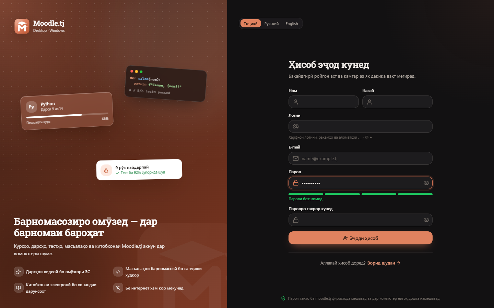

  

<h1 align="center">Moodle.tj Desktop</h1>

  The official Windows and macOS app of the <a href="https://moodle.tj">Moodle.tj</a> learning platform —
  courses, lessons, quizzes, coding tasks, an AI tutor and the digital library, fast and even offline.

  <a href="https://github.com/imomzoda-dev/MoodleTjDesktop/releases/latest"><b>⬇ Download for Windows and macOS</b></a>
  &nbsp;·&nbsp; <a href="README.ru.md">Русский</a>
  &nbsp;·&nbsp; <a href="CHANGELOG.md">What's new</a>

  
  

## Features

**Learning**
- Home with a personal greeting, streak and progress, *Continue learning*, today's plan, upcoming deadlines and popular courses.
- *All courses* with a large search, a filter panel (subject, level, language, price) and sorting; enrolment and enrolment requests with a document.
- Lessons: video that resumes where you stopped, highlighted code, PDF materials in a built-in viewer, discussion with replies and likes.
- **AI tutor** in a side panel: live streamed answers, Markdown and highlighted code, model choice, history.
- Quizzes with a timer, single/multiple/text questions, protection against leaving by accident, a detailed review.
- Assignments with drag-and-drop upload, grade and teacher feedback.
- Coding tasks in the Monaco editor: *Run* with input, *Submit* with verdicts (AC/WA/CE/RE/TLE) and per-test results; an online compiler with your own files.

**Workspace** — a code workspace on your computer, the same as in Sakina AI Desktop: a project folder with the file explorer, code search and `Ctrl+P`, the Monaco editor with tabs, a real terminal (PowerShell, CMD, Git Bash), Git (changes, commits, branches, pull/push) and the project's tasks in one click.

**Library** — showcase, collections, authors, search, a PDF/EPUB reader that remembers your page, notes and quotes, *My shelf*, purchase requests for paid books (the site's rules — watermark and daily limit — always apply).

**Community** — news with likes and comments, course forums, the community chat with pictures, replies and read marks, a notification centre with Windows notifications and a taskbar badge.

**Motivation** — achievements, streaks and an activity calendar, the leaderboard, certificates (claim, view, save, verification link) and certificate verification.

**Teachers** — courses (create, edit, translations, cover), lessons in every course language with new-lesson, duplicate and drag-and-drop order, course analytics with reminders, quiz results per lesson, a visual lesson editor as on the site (headings, lists, colours, code, pictures, video), materials, quiz builder with bulk import, assignments, coding tasks with tests and a reference-solution check, an AI assistant for lesson authors, grading, a student's quiz answers straight from the notification, student progress and course analytics.

**Administrators** — premium and enrolment requests, messages, announcements, users, analytics in the app (overview with trends, students at risk, campaigns with sending and exclusions, the delivery log, student cards, CSV export) and the full site admin in a secure, auto-signed-in window.

**Desktop quality** — three interface languages (Tajik by default, Russian, English), light/dark themes with Windows 11 Mica, `Ctrl+K` command palette, keyboard shortcuts (`Ctrl+/`), offline mode with a queue of actions sent when the connection returns, `moodletj://` links, tray, start at login, automatic updates from GitHub Releases on Windows and macOS.

  
  

  
  

  
  

  
  

## Installation

1. Download `Moodle.tj-Desktop-Setup-<version>.exe` from [Releases](https://github.com/imomzoda-dev/MoodleTjDesktop/releases/latest).
2. Run it and choose the folder. Updating keeps your sign-in, settings and offline data.
3. The installer is **not code-signed**: Windows SmartScreen may show *“Windows protected your PC”* — click **More info → Run anyway**.

**Requirements:** Windows 10/11 x64, 4 GB RAM, about 400 MB of disk space, a Moodle.tj account.

### macOS (Apple Silicon: M1–M5)

1. Download `Moodle.tj-Desktop-<version>-arm64.dmg` from [Releases](https://github.com/imomzoda-dev/MoodleTjDesktop/releases/latest), open it and drag **Moodle.tj Desktop** into **Applications**.
2. The app is not signed with an Apple Developer ID, so the first start is blocked once: open it, then go to **System Settings → Privacy & Security** and click **Open Anyway** (or right-click the app → **Open**).
3. When a new version comes out, the app shows it; *Update* downloads and checks it, and *Restart* installs it and opens the new version. (Keep the app in **Applications**; if it runs from the DMG, *Update* opens the new DMG instead.)

Windows and macOS each update from their own newest build, so one system never waits for the other.

**Requirements:** macOS 12 or later on Apple Silicon.

## Privacy and security

- Your password is never stored. The server issues a token for this device; it is encrypted with Windows DPAPI and never reaches the interface, logs or files in plain text.
- *Sign out* ends the session on this device only and removes this account's offline data.
- No telemetry. The app talks to `moodle.tj` (and, for Gemini models of the AI tutor, to Google), and to GitHub to check for updates.
- Strict sandbox: context isolation, no Node.js in the interface, a strict Content-Security-Policy, all server HTML sanitized, no device permissions.

## Versions

| Version | Date | Downloads |
|---|---|---|
| [1.0.0](https://github.com/imomzoda-dev/MoodleTjDesktop/releases/tag/v1.0.0) | 30.10.2026 |  |

## License

© 2026 Imomzoda Mehriddin. Free to use — see [LICENSE.txt](LICENSE.txt).
