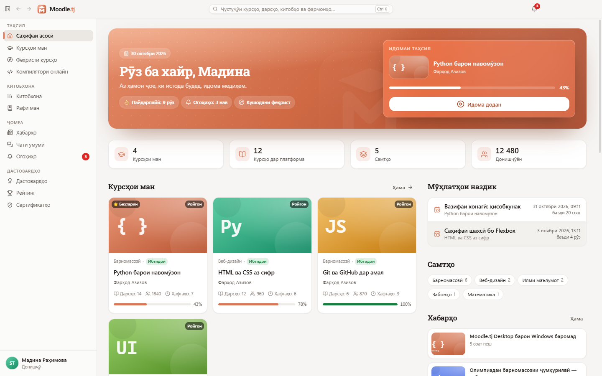
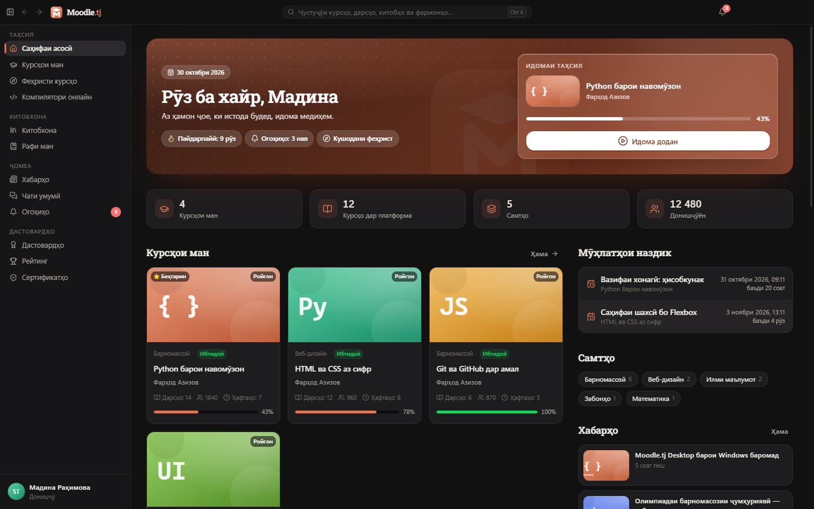
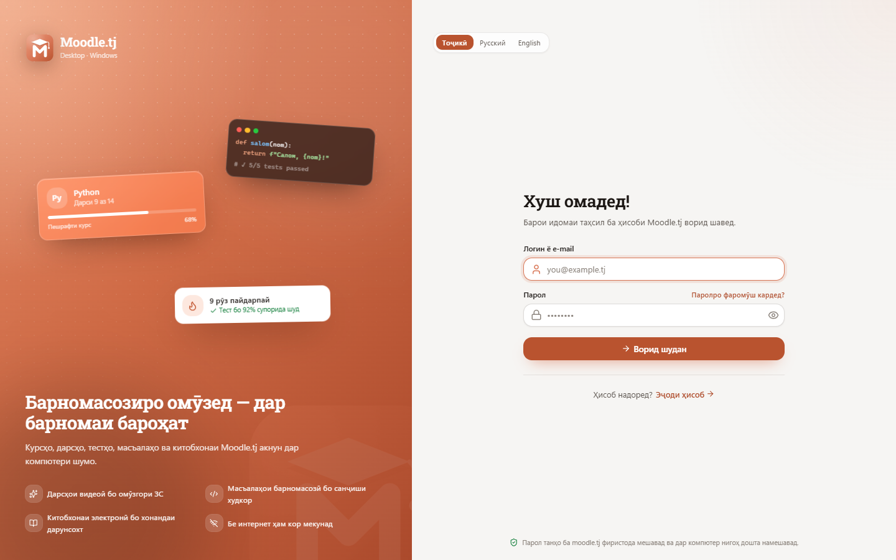
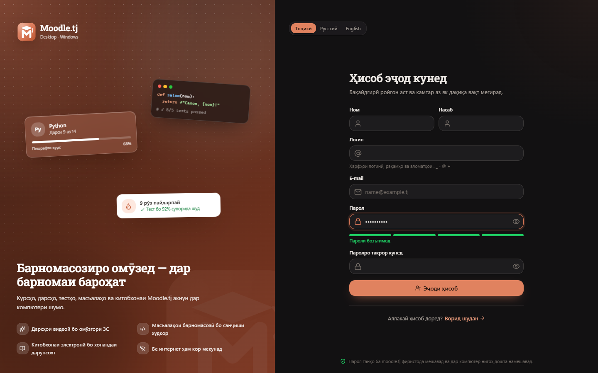
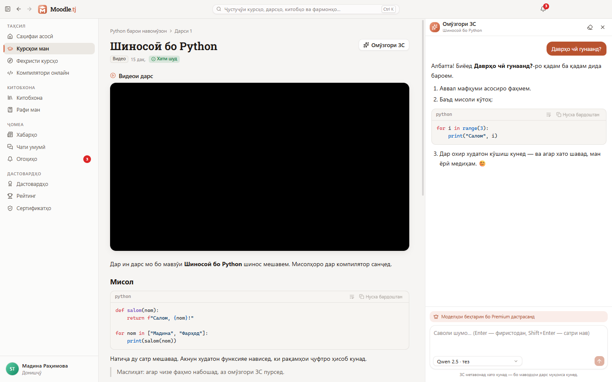
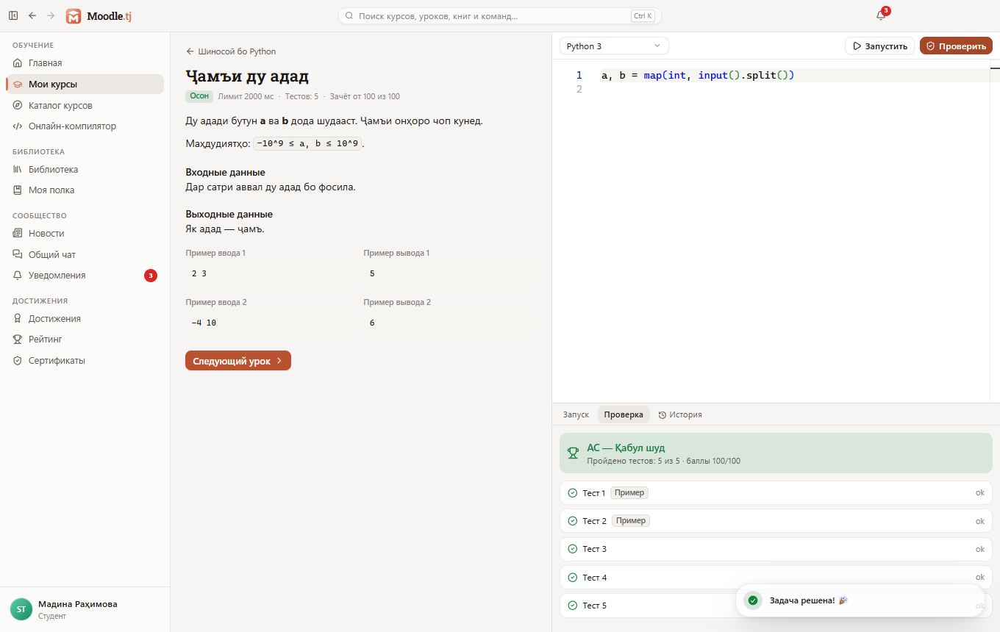

  

<h1 align="center">Moodle.tj Desktop</h1>

  Официальное приложение учебной платформы <a href="https://moodle.tj">Moodle.tj</a> для Windows —
  курсы, уроки, тесты, задачи по программированию, ИИ-репетитор и библиотека. Быстро и даже без интернета.

  <a href="https://github.com/imomzoda-dev/MoodleTjDesktop/releases/latest"><b>⬇ Скачать для Windows</b></a>
  &nbsp;·&nbsp; <a href="README.md">English</a>
  &nbsp;·&nbsp; <a href="CHANGELOG.md">Что нового</a>

  
  

## Возможности

**Обучение**
- Главная: приветствие, «Продолжить обучение», ближайшие сроки, популярные и новые курсы.
- Каталог с поиском и фильтрами (направление, уровень, язык, цена), запись на курс и заявка с документом.
- Уроки: видео продолжается с места остановки, код с подсветкой, PDF во встроенном просмотре, обсуждение с ответами и лайками.
- **ИИ-репетитор** в боковой панели: ответ печатается вживую, Markdown и код, выбор модели, история.
- Тесты с таймером, вопросы с одним/несколькими/текстовым ответом, защита от случайного выхода, подробный разбор.
- Задания с перетаскиванием файла, оценкой и отзывом преподавателя.
- Задачи по программированию в редакторе Monaco: «Запустить» с вводом, «Проверить» с вердиктами (AC/WA/CE/RE/TLE); онлайн-компилятор с личными файлами.

**Рабочее место** — среда для кода на вашем компьютере, как в Sakina AI Desktop: папка проекта, проводник, поиск по коду и `Ctrl+P`, редактор Monaco с вкладками, настоящий терминал (PowerShell, CMD, Git Bash), Git (изменения, коммиты, ветки, pull/push) и задачи проекта в один клик.

**Библиотека** — подборки, разделы, поиск, читалка PDF и EPUB с сохранением страницы, заметки и цитаты, «Моя полка», заявки на платные книги (правила сайта — водяной знак и лимит — всегда соблюдаются).

**Сообщество** — новости с лайками и комментариями, форумы курсов, общий чат с фото, ответами и отметками «прочитано», центр уведомлений, уведомления Windows и счётчик на панели задач.

**Мотивация** — достижения, серия дней и календарь активности, рейтинг, сертификаты (получение, просмотр, сохранение, ссылка проверки) и проверка подлинности.

**Преподавателям** — курсы (создание, правка, переводы, обложка), порядок уроков перетаскиванием, визуальный редактор урока, как на сайте, материалы, конструктор тестов с массовым добавлением, задания, задачи с тестами и проверкой эталонного решения, ИИ-помощник автора урока, проверка работ, прогресс студентов, аналитика курса.

**Администраторам** — заявки на Premium и на курсы, обращения, объявления, пользователи, аналитика (зона риска, рассылки) и полная админка сайта в защищённом окне с автоматическим входом.

**Качество настольного приложения** — три языка интерфейса (таджикский по умолчанию, русский, английский), светлая и тёмная темы с эффектом Mica, палитра `Ctrl+K`, горячие клавиши (`Ctrl+/`), офлайн-режим с очередью действий, ссылки `moodletj://`, трей, автозапуск, автообновление из GitHub Releases.

  
  

  
  

## Установка

1. Скачайте `Moodle.tj-Desktop-Setup-<версия>.exe` из [Releases](https://github.com/imomzoda-dev/MoodleTjDesktop/releases/latest).
2. Запустите и выберите папку. При обновлении вход, настройки и офлайн-данные сохраняются.
3. Установщик **не подписан** сертификатом: Windows SmartScreen может показать «Система Windows защитила ваш компьютер» — нажмите **Подробнее → Выполнить в любом случае**.

**Требования:** Windows 10/11 x64, 4 ГБ ОЗУ, около 400 МБ на диске, аккаунт Moodle.tj.

### macOS (Apple Silicon: M1–M5)

1. Скачайте `Moodle.tj-Desktop-<версия>-arm64.dmg` из [Releases](https://github.com/imomzoda-dev/MoodleTjDesktop/releases/latest), откройте его и перетащите **Moodle.tj Desktop** в **Программы**.
2. Программа не подписана сертификатом Apple, поэтому первый запуск macOS один раз заблокирует: откройте программу, затем **Системные настройки → Конфиденциальность и безопасность → «Всё равно открыть»** (или правый клик по программе → **Открыть**).
3. Когда выйдет новая версия, программа покажет это, а кнопка «Обновить» скачает новый DMG.

**Требования:** macOS 12 и новее на Apple Silicon.

## Конфиденциальность и безопасность

- Пароль не сохраняется. Сервер выдаёт токен этому устройству; он шифруется Windows DPAPI и никогда не попадает в интерфейс, журналы или файлы в открытом виде.
- «Выйти» завершает сеанс только на этом компьютере и удаляет офлайн-данные аккаунта.
- Никакой телеметрии. Приложение обращается к `moodle.tj` (для моделей Gemini ИИ-репетитора — к Google) и к GitHub для проверки обновлений.
- Строгая изоляция: contextIsolation, sandbox, без Node.js в интерфейсе, строгая CSP, очистка HTML с сервера, запрет всех разрешений устройства.

## Лицензия

© 2026 Имомзода Мехриддин. Бесплатно для использования — см. [LICENSE.txt](LICENSE.txt).
